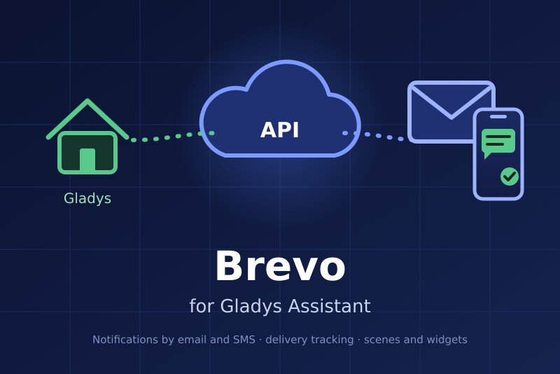
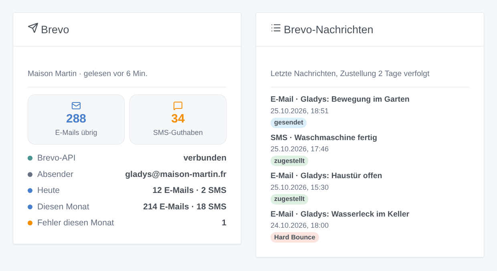
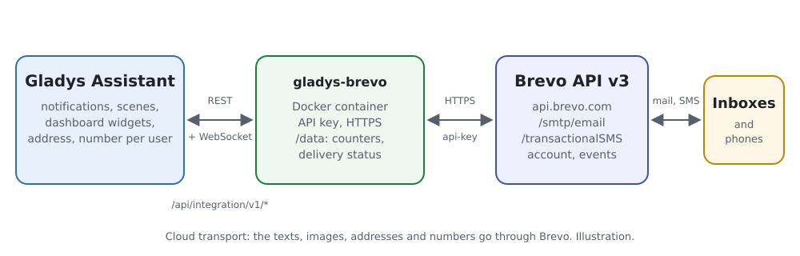
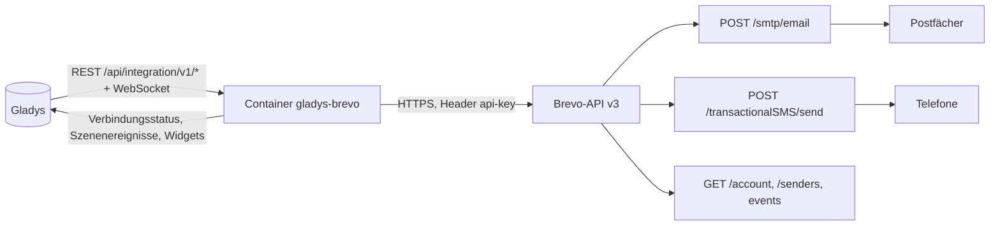
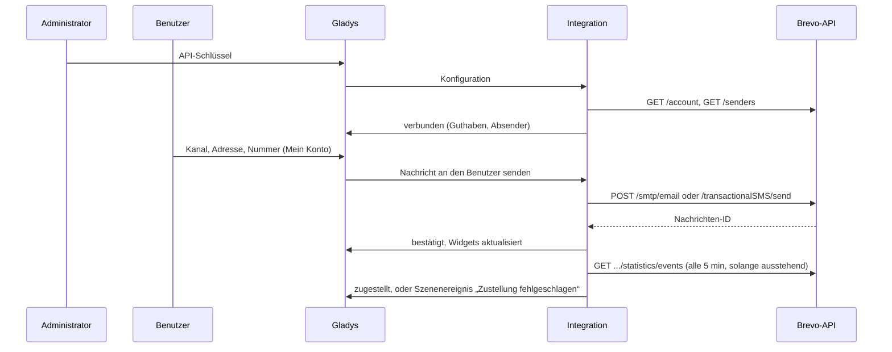

# Gladys Brevo

[English](README.md) · [Français](README.fr.md) · **Deutsch** · [Español](README.es.md)

[](LICENSE)
[](https://github.com/William-De71/gladys-brevo/releases)
[](https://github.com/William-De71/gladys-brevo/actions/workflows/release.yml)
[](https://gladysassistant.com)



Externe Integration für [Gladys Assistant](https://gladysassistant.com), die die Benachrichtigungen von Gladys **per E-Mail, per SMS oder auf beiden Wegen über [Brevo](https://www.brevo.com)** (früher Sendinblue) mit dessen offizieller API sendet. Szenen können außerdem beliebigen Personen E-Mails oder SMS schicken, auf fehlgeschlagene Zustellungen und niedriges SMS-Guthaben reagieren, und zwei Dashboard-Widgets zeigen das Konto und die letzten Nachrichten.

Benutzerdokumentation: [English](docs/en.md) · [Français](docs/fr.md) · [Deutsch](docs/de.md) · [Español](docs/es.md).

> Community-Integration, weder mit Brevo verbunden noch von Brevo unterstützt.

## Funktionen

- **Benachrichtigungskanal** (nur Senden): Jeder Benutzer wählt im Block „Mein Konto“ E-Mail, SMS oder beides; jede an ihn gerichtete Gladys-Benachrichtigung geht auf diesem Weg raus.
- **Kamerabilder als E-Mail-Anhang**; der Betreff besteht aus einem Präfix und der ersten Zeile der Benachrichtigung.
- **Automatische Einrichtung**: der erste aktive E-Mail-Absender des Kontos oder der aus der Konfiguration; nationale Nummern erhalten die Standard-Ländervorwahl.
- **Zustellverfolgung**: gesendet, zugestellt, unzustellbar, blockiert… aus den Ereignissen von Brevo, zwei Tage lang.
- **Szenenauslöser**: Nachricht nicht gesendet, Zustellung fehlgeschlagen, SMS-Guthaben niedrig.
- **Szenenaktionen**: E-Mail senden, SMS senden, Brevo-Konto lesen.
- **Dashboard-Widgets**: Brevo-Konto, letzte Nachrichten.
- **Schaltflächen im Konfigurationsbildschirm**: Verbindung testen, Test-E-Mail und/oder -SMS senden.
- Überall auf Englisch, Französisch, Deutsch und Spanisch.



## Funktionsweise





Von der Konfiguration bis zur zugestellten Nachricht:



Jede Nachricht trägt das Tag `gladys`: Sie finden die Nachrichten von Gladys in den Brevo-Protokollen, und die Integration ordnet die Zustellereignisse den gespeicherten Nachrichten-IDs zu.

### Transport

`transports: ["cloud"]`: Die Integration spricht nur mit der Brevo-API (`api.brevo.com`). Die Texte, Bilder, Adressen und Nummern verlassen Ihr Netzwerk zu Brevo und gehen dann über die Mailserver und die Mobilfunkanbieter.

## Benachrichtigungen, Adressen und Nummern

| Eingegebene Nummer   | Gesendet an                                |
| -------------------- | ------------------------------------------ |
| `+33 6 12 34 56 78`  | `+33612345678`                             |
| `0033.6.12.34.56.78` | `+33612345678`                             |
| `06 12 34 56 78`     | `+33612345678` (Standard-Ländervorwahl 33) |
| `+32 470 12 34 56`   | `+32470123456`                             |

Eine E-Mail enthält den Text und eine HTML-Kopie davon (maskiert, Zeilenumbrüche erhalten) sowie das Kamerabild der Nachricht, falls vorhanden. Eine SMS ist eine Transaktions-SMS (nie mit dem „STOP“-Hinweis von Werbe-SMS), nur dann in Unicode, wenn der Text es braucht, und auf 1.000 Zeichen gekürzt. Mit „E-Mail und SMS“ schlägt eine Benachrichtigung nur fehl, wenn keiner der beiden Kanäle durchgegangen ist.

## Szenenauslöser, Aktionen und Widgets

| Art      | Schlüssel          | Anwendungsfall                                                                             |
| -------- | ------------------ | ------------------------------------------------------------------------------------------ |
| Auslöser | `message_not_sent` | Über den anderen Kanal warnen, wenn einer ausfällt (Guthaben, Schlüssel, IP, Brevo)        |
| Auslöser | `delivery_failed`  | Wissen, dass ein Alarm nicht angekommen ist: Bounce, Sperre, Spam-Meldung, SMS abgelehnt   |
| Auslöser | `credits_low`      | Das SMS-Guthaben aufladen, bevor es aufgebraucht ist                                       |
| Aktion   | `send_email`       | Jemandem ohne Gladys-Konto (Nachbar, Babysitter) oder mehreren Personen eine E-Mail senden |
| Aktion   | `send_sms`         | Dasselbe per SMS                                                                           |
| Aktion   | `get_account`      | Guthaben und Nachrichten des Tages oder Monats in einem Bericht oder einer Bedingung       |
| Widget   | `account`          | Guthaben, API-Zustand, Absender, Nachrichten heute und diesen Monat, Fehler                |
| Widget   | `activity`         | Die letzten Nachrichten mit ihrem Zustellstatus                                            |

Beispiele: _Alarm wird ausgelöst_ → SMS an den Nachbarn; _SMS mangels Guthaben nicht gesendet_ → E-Mail an den Administrator; _Hard Bounce_ → den Administrator mit dem maskierten Empfänger und dem Betreff benachrichtigen. Eine Szenenaktion löst nie einen Auslöser aus, und `message_not_sent` löst einmal pro Kanal aus, bis eine Nachricht durchgeht: Eine Szene, die über denselben Kanal warnt, kann keine Schleife bilden.

## Voraussetzungen

- Gladys Assistant 5.1.0 oder neuer (Widgets und Szenen); ältere Instanzen können die Integration nicht installieren.
- Ein Brevo-Konto (kostenloser Tarif: 300 E-Mails pro Tag), ein bestätigter Absender oder eine authentifizierte Domain, SMS-Guthaben für die SMS.
- Die öffentliche IP-Adresse des Hauses in Brevo autorisiert (Sicherheit → Autorisierte IPs), wenn das Konto unbekannte Adressen blockiert.

## Installation

- **Aus dem Store**: Integrationen → Brevo → Installieren.
- **Über die URL des Repositorys**: Integrationen → externe Integration → `https://github.com/William-De71/gladys-brevo`.
- **Entwicklermodus**: `npm start` mit den von Gladys angegebenen Variablen ausführen (siehe Entwicklung).

## Konfiguration

| Feld                           | Standard | Bedeutung                                                         |
| ------------------------------ | -------- | ----------------------------------------------------------------- |
| API-Schlüssel                  | —        | `secret` (`xkeysib-…`), verschlüsselt gespeichert                 |
| Absenderadresse                | auto     | Erster aktiver Absender des Kontos                                |
| Absendername                   | Gladys   | Name, den die Empfänger sehen                                     |
| Betreff-Präfix                 | Gladys   | `Gladys: <erste Zeile>`                                           |
| SMS-Absender                   | Gladys   | Höchstens 11 Buchstaben und Ziffern                               |
| Standard-Ländervorwahl         | 33       | Wird Nummern ohne Vorwahl vorangestellt                           |
| Warnung bei wenig SMS-Guthaben | 20       | Schwelle von `credits_low`, 0 = aus                               |
| Zustellung verfolgen           | an       | Ereignisse alle 5 min, solange eine Nachricht wartet, 2 Tage lang |
| Mein Konto                     | —        | Pro Benutzer: Kanal (E-Mail, SMS, beides), Adresse, Nummer        |

## Verwendung

1. Erzeugen Sie in Brevo einen API-Schlüssel, fügen Sie ihn in die Konfiguration ein und klicken Sie dann auf **Verbindung testen** und **Test senden**.
2. Jeder Benutzer wählt seinen Kanal und gibt seine Adresse und/oder Nummer unter **Mein Konto** ein.
3. Fügen Sie die Widgets einem Dashboard hinzu und bauen Sie Szenen mit den Auslösern und Aktionen.

## Entwicklung

```bash
npm install
npm test                       # node --test, nie mit Netzwerkzugriff
npm run lint                   # ESLint
npm run format:check           # Prettier
npx github:GladysAssistant/integration-store . --skip-image-check
scripts/build-cover.sh         # cover.jpg aus docs/assets/cover.svg
docs/illustrations/render.sh   # docs/assets/widgets.<lang>.png
```

Lokal liest das SDK `GLADYS_HOST_API_URL`, `GLADYS_INTEGRATION_TOKEN` und `GLADYS_INTEGRATION_SELECTOR` (von Gladys im Entwicklermodus angegeben). `DEBUG=gladys-integration-sdk` zeigt die Protokolle des SDK.

Die Tests decken den API-Client (Header, Fehlerarten, unbekannte IP-Adresse), die Fehlergründe, das Konto, die Absender, die E-Mail- und SMS-Inhalte, die Wiederholungen (nur 429, nach dem angekündigten Reset), die Zustellereignisse und ihre Zuordnung über einen Neustart hinweg, die Adressen und Nummern, die Szenenereignisse und ihre Übergänge, die Widgets (`validateWidgetContent`), das Manifest, die vier Sprachen, das Release-Skript und die ganze Integration gegen das falsche Gladys des SDK und eine falsche Brevo-API ab. `test/structure.test.js` friert jeden Schlüssel ein, den Benutzer speichern.

## Release-Ablauf


Jeder Merge auf `main` startet die CI und berechnet dann die Version aus den [Conventional Commits](https://www.conventionalcommits.org/) seit dem letzten Tag: `feat` → Minor, `fix` / `perf` → Patch, `!` oder `BREAKING CHANGE` → Major (ein Minor unter 1.0.0); `docs`, `chore`, `ci`, `test`, `style`, `refactor`, `build` allein veröffentlichen nichts. Der Changelog-Abschnitt wird generiert, der Tag gepusht, das Multi-Architektur-Image gebaut, dann erhält `main` den Release-Commit, das GitHub Release wird erstellt, und ein letzter Job prüft das öffentliche Image, den Store-Validator und das Topic.

- Der Titel des Pull Requests wird zum Squash-Commit und dann zur Changelog-Zeile: Schreiben Sie ihn auf Englisch, für den Benutzer (`pr-title.yml` prüft ihn). Bearbeiten Sie `CHANGELOG.md` nie von Hand.
- 1.0.0 ist eine Entscheidung: Actions → Release → Run workflow mit `release-as: 1.0.0`. `dry-run` zeigt die Version und die Notizen, ohne zu veröffentlichen.
- **Geschützter Branch**: Das Release pusht seinen Commit mit `GITHUB_TOKEN` auf `main`. Mit einem Ruleset auf `main`, das strenger ist als „kein Löschen, kein Force-Push“, fügen Sie GitHub Actions zu dessen Bypass-Liste hinzu (oder pushen Sie über eine GitHub App), sonst schlägt der Publish-Job mit Anweisungen fehl.
- Machen Sie nach dem ersten Release das Paket `ghcr.io` öffentlich (Package settings → Change visibility), sonst kann Gladys es nicht herunterladen.

## Fehlerbehebung

Siehe [docs/de.md](docs/de.md#fehlerbehebung). Melden Sie Probleme mit den Versionen von Gladys und der Integration, dem Tarif, den verwendeten Kanälen und den Protokollen der Integration (Adressen und Nummern sind maskiert; fügen Sie nie den API-Schlüssel ein).

## Mitwirken

Issues und Pull Requests sind willkommen. Führen Sie vor dem Öffnen eines Pull Requests `npm run format:check && npm run lint && npm test` aus und lassen Sie jeden gespeicherten Schlüssel unverändert (siehe [CLAUDE.md](CLAUDE.md)).

## Sicherheit

Siehe [SECURITY.md](SECURITY.md): Melden Sie Schwachstellen vertraulich. Der API-Schlüssel ist ein `secret`-Feld, wird nur im Header `api-key` gesendet, nie protokolliert, nie in einer URL, einem Szenenereignis oder einer Fehlermeldung. Adressen und Nummern sind in den Protokollen, den Szenenereignissen und `/data` maskiert. Der Text einer Benachrichtigung wird im HTML der E-Mail immer maskiert. Ein Versand wird nach einer Zeitüberschreitung oder einem Serverfehler nie wiederholt, damit ein Alarm nicht doppelt gesendet wird.

## Kommende Screenshots

Die Bilder oben sind Illustrationen, keine Screenshots. Echte Screenshots kommen nach `docs/assets/screenshots/` (PNG, 1280 × 800): `configuration.png`, `my-account.png`, `scene-trigger.png`, `dashboard.png`, `email.png`.

## Lizenz

[Apache License 2.0](LICENSE) — siehe auch [NOTICE](NOTICE). Brevo ist eine Marke der Sendinblue SAS; diese Community-Integration ist nicht mit ihr verbunden. Danke an die Dokumentation und das SDK von Gladys.
