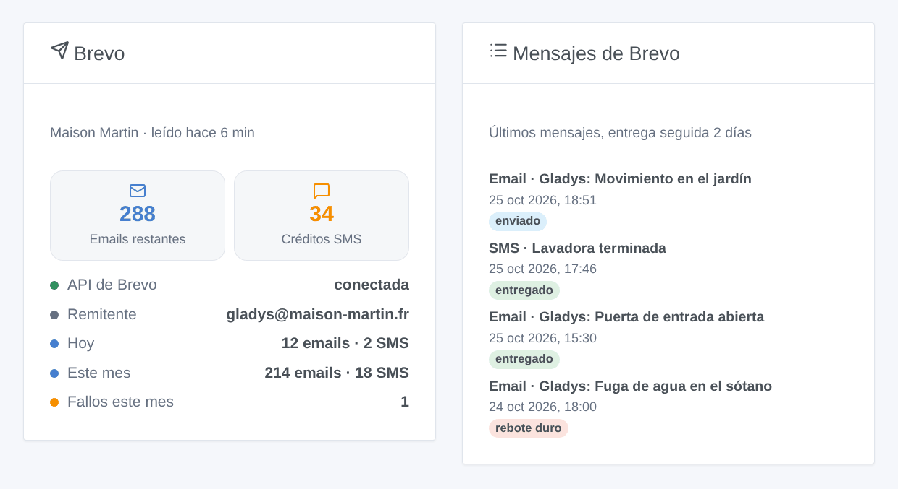
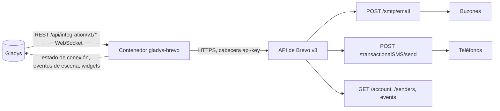
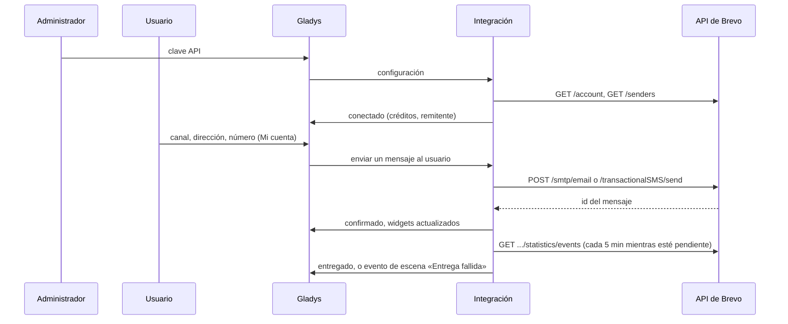

# Gladys Brevo

[English](README.md) · [Français](README.fr.md) · [Deutsch](README.de.md) · **Español**

[](LICENSE)
[](https://github.com/William-De71/gladys-brevo/releases)
[](https://github.com/William-De71/gladys-brevo/actions/workflows/release.yml)
[](https://gladysassistant.com)


Integración externa de [Gladys Assistant](https://gladysassistant.com) que envía las notificaciones de Gladys **por email, por SMS o por ambos a través de [Brevo](https://www.brevo.com)** (antes Sendinblue), con su API oficial. Las escenas también pueden enviar un email o un SMS a cualquiera, reaccionar a las entregas fallidas y a la falta de créditos SMS, y dos widgets del panel muestran la cuenta y los últimos mensajes.

Documentación de usuario: [English](docs/en.md) · [Français](docs/fr.md) · [Deutsch](docs/de.md) · [Español](docs/es.md).

> Integración comunitaria, no afiliada a Brevo ni respaldada por Brevo.

## Funcionalidades

- **Canal de notificación** (solo envío): cada usuario elige email, SMS o ambos en el bloque «Mi cuenta»; toda notificación de Gladys dirigida a él sale por esa vía.
- **Capturas de cámara como adjuntos del email**; el asunto es un prefijo seguido de la primera línea de la notificación.
- **Configuración automática**: el primer remitente de email activo de la cuenta, o el de la configuración; los números nacionales reciben el prefijo de país por defecto.
- **Seguimiento de la entrega**: enviado, entregado, rebotado, bloqueado… leído de los eventos de Brevo durante dos días.
- **Disparadores de escena**: mensaje no enviado, entrega fallida, pocos créditos SMS.
- **Acciones de escena**: enviar un email, enviar un SMS, leer la cuenta de Brevo.
- **Widgets del panel**: cuenta de Brevo, últimos mensajes.
- **Botones de la pantalla de configuración**: probar la conexión, enviar un email y/o un SMS de prueba.
- Inglés, francés, alemán y español en todas partes.



## Funcionamiento




De la configuración a un mensaje entregado:



Cada mensaje lleva la etiqueta `gladys`: encontrará los mensajes de Gladys en los registros de Brevo, y la integración asocia los eventos de entrega a los id de mensaje que ha guardado.

### Transporte

`transports: ["cloud"]`: la integración solo habla con la API de Brevo (`api.brevo.com`). Los textos, imágenes, direcciones y números salen de su red hacia Brevo y después hacia los servidores de correo y los operadores móviles.

## Notificaciones, direcciones y números

| Número introducido   | Enviado a                                       |
| -------------------- | ----------------------------------------------- |
| `+33 6 12 34 56 78`  | `+33612345678`                                  |
| `0033.6.12.34.56.78` | `+33612345678`                                  |
| `06 12 34 56 78`     | `+33612345678` (prefijo de país por defecto 33) |
| `+32 470 12 34 56`   | `+32470123456`                                  |

Un email contiene el texto y una copia HTML de este (escapada, con los saltos de línea conservados), además de la imagen de cámara del mensaje cuando la hay. Un SMS es un SMS transaccional (nunca con la mención «STOP» de los SMS publicitarios), en unicode solo cuando el texto lo necesita, cortado a 1.000 caracteres. Con «Email y SMS», una notificación solo falla cuando ninguno de los dos canales ha salido.

## Disparadores de escena, acciones y widgets

| Tipo       | Clave              | Caso de uso                                                                                 |
| ---------- | ------------------ | ------------------------------------------------------------------------------------------- |
| Disparador | `message_not_sent` | Avisar por el otro canal cuando uno deja de funcionar (créditos, clave, IP, Brevo)          |
| Disparador | `delivery_failed`  | Saber que una alerta no ha llegado: rebote, bloqueo, denuncia de spam, SMS rechazado        |
| Disparador | `credits_low`      | Recargar los créditos SMS antes de que se agoten                                            |
| Acción     | `send_email`       | Enviar un email a alguien que no es usuario de Gladys (vecino, canguro) o a varias personas |
| Acción     | `send_sms`         | Lo mismo por SMS                                                                            |
| Acción     | `get_account`      | Créditos y mensajes del día o del mes en un informe o una condición                         |
| Widget     | `account`          | Créditos, estado de la API, remitente, mensajes de hoy y de este mes, fallos                |
| Widget     | `activity`         | Los últimos mensajes con su estado de entrega                                               |

Ejemplos: _salta la alarma_ → SMS al vecino; _SMS no enviado por falta de créditos_ → email al administrador; _rebote duro_ → notificar al administrador con el destinatario enmascarado y el asunto. Una acción de escena nunca activa un disparador, y `message_not_sent` se activa una vez por canal hasta que un mensaje pasa: una escena que avisa por el mismo canal no puede entrar en bucle.

## Requisitos previos

- Gladys Assistant 5.3.0 o posterior (palabras clave y países del catálogo de Gladys 5.3, widgets y escenas); las instancias más antiguas no pueden instalar la integración.
- Una cuenta de Brevo (plan gratuito: 300 emails al día), un remitente verificado o un dominio autenticado, créditos SMS para los SMS.
- La dirección IP pública de la casa autorizada en Brevo (Seguridad → IP autorizadas) cuando la cuenta bloquea las direcciones desconocidas.

## Instalación

- **Desde la tienda**: Integraciones → Brevo → Instalar.
- **Desde la URL del repositorio**: Integraciones → integración externa → `https://github.com/William-De71/gladys-brevo`.
- **Modo desarrollador**: ejecute `npm start` con las variables que da Gladys (ver Desarrollo).

## Configuración

| Campo                        | Por defecto | Significado                                                   |
| ---------------------------- | ----------- | ------------------------------------------------------------- |
| Clave API                    | —           | `secret` (`xkeysib-…`), guardada cifrada                      |
| Dirección del remitente      | auto        | Primer remitente activo de la cuenta                          |
| Nombre del remitente         | Gladys      | Nombre que ven los destinatarios                              |
| Prefijo del asunto           | Gladys      | `Gladys: <primera línea>`                                     |
| Remitente de los SMS         | Gladys      | Hasta 11 letras y cifras                                      |
| Prefijo de país por defecto  | 33          | Se añade a los números introducidos sin prefijo               |
| Alerta de pocos créditos SMS | 20          | Umbral de `credits_low`, 0 = desactivada                      |
| Seguir la entrega            | sí          | Eventos cada 5 min mientras un mensaje espera, durante 2 días |
| Mi cuenta                    | —           | Por usuario: canal (email, SMS, ambos), dirección, número     |

## Uso

1. Genere una clave API en Brevo, péguela en la configuración y pulse **Probar la conexión** y **Enviar una prueba**.
2. Cada usuario elige su canal e introduce su dirección y/o número en **Mi cuenta**.
3. Añada los widgets a un panel y cree escenas con los disparadores y las acciones.

## Desarrollo

```bash
npm install
npm test                       # node --test, nunca accede a la red
npm run lint                   # ESLint
npm run format:check           # Prettier
npx github:GladysAssistant/integration-store . --skip-image-check
scripts/build-cover.sh         # cover.jpg a partir de docs/assets/cover.svg
docs/illustrations/render.sh   # docs/assets/widgets.<lang>.png
```

En local, el SDK lee `GLADYS_HOST_API_URL`, `GLADYS_INTEGRATION_TOKEN` y `GLADYS_INTEGRATION_SELECTOR` (que da Gladys en modo desarrollador). `DEBUG=gladys-integration-sdk` muestra los registros del SDK.

Las pruebas cubren el cliente de la API (cabeceras, tipos de error, dirección IP desconocida), los motivos de fallo, la cuenta, los remitentes, los cuerpos del email y del SMS, los reintentos (solo 429, tras el reinicio anunciado), los eventos de entrega y su asociación tras un reinicio, las direcciones y los números, los eventos de escena y sus transiciones, los widgets (`validateWidgetContent`), el manifiesto, los cuatro idiomas, el script de publicación y toda la integración frente al falso Gladys del SDK y una falsa API de Brevo. `test/structure.test.js` congela cada clave que guardan los usuarios.

## Proceso de publicación


Cada fusión en `main` ejecuta la CI y después calcula la versión a partir de los [Conventional Commits](https://www.conventionalcommits.org/) desde la última etiqueta: `feat` → menor, `fix` / `perf` → parche, `!` o `BREAKING CHANGE` → mayor (una menor por debajo de 1.0.0); `docs`, `chore`, `ci`, `test`, `style`, `refactor`, `build` solos no publican nada. Se genera la sección del changelog, se sube la etiqueta, se construye la imagen multiarquitectura, después `main` recibe el commit de publicación, se crea la GitHub Release y un último job comprueba la imagen pública, el validador de la tienda y el topic.

- El título de la pull request se convierte en el commit squash y después en la línea del changelog: escríbalo en inglés, para el usuario (`pr-title.yml` lo comprueba). No edite nunca `CHANGELOG.md` a mano.
- 1.0.0 es una decisión: Actions → Release → Run workflow con `release-as: 1.0.0`. `dry-run` muestra la versión y las notas sin publicar.
- **Rama protegida**: la publicación sube su commit a `main` con `GITHUB_TOKEN`. Con un ruleset en `main` más estricto que «sin borrado, sin force push», añada GitHub Actions a su lista de bypass (o suba mediante una GitHub App); si no, el job de publicación falla con instrucciones.
- Tras la primera publicación, haga público el paquete `ghcr.io` (Package settings → Change visibility); si no, Gladys no puede descargarlo.

## Solución de problemas

Vea [docs/es.md](docs/es.md#solución-de-problemas). Informe de los problemas con las versiones de Gladys y de la integración, el plan, los canales usados y los registros de la integración (las direcciones y los números aparecen enmascarados; no pegue nunca la clave API).

## Contribuir

Las issues y las pull requests son bienvenidas. Ejecute `npm run format:check && npm run lint && npm test` antes de abrir una pull request, y mantenga sin cambios cada clave guardada (ver [CLAUDE.md](CLAUDE.md)).

## Seguridad

Vea [SECURITY.md](SECURITY.md): informe de las vulnerabilidades en privado. La clave API es un campo `secret`, enviado solo en la cabecera `api-key`, nunca registrado, nunca en una URL, un evento de escena o un mensaje de error. Las direcciones y los números aparecen enmascarados en los registros, los eventos de escena y `/data`. El texto de una notificación siempre se escapa en el HTML del email. Un envío nunca se reintenta tras un tiempo de espera agotado o un error del servidor, para que una alerta no se envíe dos veces.

## Capturas de pantalla pendientes

Las imágenes de arriba son ilustraciones, no capturas de pantalla. Las capturas reales irán en `docs/assets/screenshots/` (PNG, 1280 × 800): `configuration.png`, `my-account.png`, `scene-trigger.png`, `dashboard.png`, `email.png`.

## Licencia

[Apache License 2.0](LICENSE) — ver también [NOTICE](NOTICE). Brevo es una marca de Sendinblue SAS; esta integración comunitaria no está afiliada a ella. Gracias a la documentación y al SDK de Gladys.
