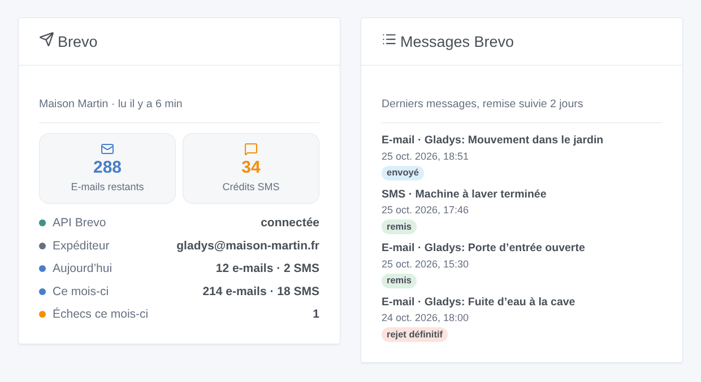
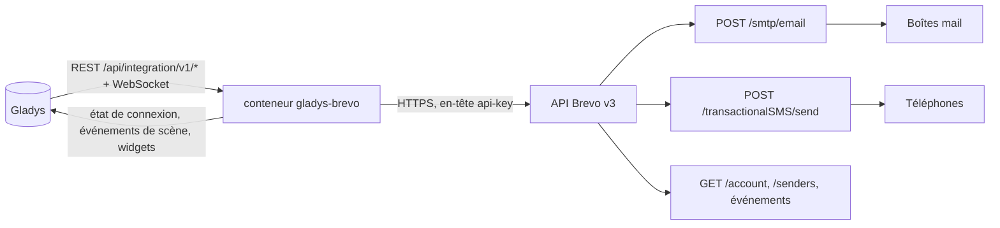
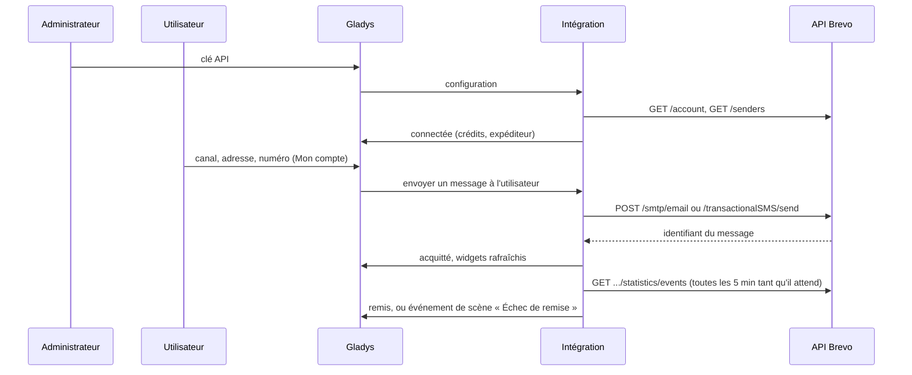

# Gladys Brevo

[English](README.md) · **Français** · [Deutsch](README.de.md) · [Español](README.es.md)

[](LICENSE)
[](https://github.com/William-De71/gladys-brevo/releases)
[](https://github.com/William-De71/gladys-brevo/actions/workflows/release.yml)
[](https://gladysassistant.com)


Intégration externe pour [Gladys Assistant](https://gladysassistant.com) qui envoie les notifications de Gladys **par e-mail, par SMS ou les deux grâce à [Brevo](https://www.brevo.com)** (ex-Sendinblue), avec son API officielle. Les scènes peuvent aussi écrire un e-mail ou un SMS à n'importe qui, réagir aux échecs de remise et aux crédits SMS bas, et deux widgets de tableau de bord affichent le compte et les derniers messages.

Documentation utilisateur : [English](docs/en.md) · [Français](docs/fr.md) · [Deutsch](docs/de.md) · [Español](docs/es.md).

> Intégration communautaire, ni affiliée ni approuvée par Brevo.

## Fonctionnalités

- **Canal de notification** (envoi seul) : chaque utilisateur choisit e-mail, SMS ou les deux dans le bloc « Mon compte » ; chaque notification Gladys qui lui est adressée part par ce canal.
- **Images de caméra en pièce jointe** ; l'objet est un préfixe suivi de la première ligne de la notification.
- **Réglage automatique** : le premier expéditeur e-mail actif du compte, ou celui de la configuration ; les numéros nationaux reçoivent l'indicatif pays par défaut.
- **Suivi de remise** : envoyé, remis, rejeté, bloqué… lu dans les événements de Brevo pendant deux jours.
- **Déclencheurs de scène** : message non envoyé, échec de remise, crédits SMS bas.
- **Actions de scène** : envoyer un e-mail, envoyer un SMS, lire le compte Brevo.
- **Widgets de tableau de bord** : compte Brevo, derniers messages.
- **Boutons de l'écran Configuration** : tester la connexion, envoyer un e-mail et/ou un SMS de test.
- Anglais, français, allemand et espagnol partout.



## Fonctionnement




De la configuration à un message remis :



Chaque message porte le tag `gladys` : vous retrouvez les messages de Gladys dans les journaux de Brevo, et l'intégration rattache les événements de remise aux identifiants de messages qu'elle a gardés.

### Transport

`transports: ["cloud"]` : l'intégration ne parle qu'à l'API Brevo (`api.brevo.com`). Les textes, images, adresses et numéros quittent votre réseau vers Brevo, puis les serveurs de messagerie et les opérateurs mobiles.

## Notifications, adresses et numéros

| Numéro saisi         | Envoyé à                                      |
| -------------------- | --------------------------------------------- |
| `+33 6 12 34 56 78`  | `+33612345678`                                |
| `0033.6.12.34.56.78` | `+33612345678`                                |
| `06 12 34 56 78`     | `+33612345678` (indicatif pays par défaut 33) |
| `+32 470 12 34 56`   | `+32470123456`                                |

Un e-mail contient le texte et sa copie HTML (échappée, retours à la ligne gardés), plus l'image de caméra du message quand il y en a une. Un SMS est un SMS transactionnel (jamais la mention « STOP » des SMS marketing), en unicode seulement quand le texte l'exige, coupé à 1 000 caractères. Avec « E-mail et SMS », une notification n'échoue que si aucun des deux canaux n'est parti.

## Déclencheurs, actions de scène et widgets

| Type        | Clé                | Cas d'usage                                                                       |
| ----------- | ------------------ | --------------------------------------------------------------------------------- |
| Déclencheur | `message_not_sent` | Prévenir par l'autre canal quand l'un ne marche plus (crédits, clé, IP, Brevo)    |
| Déclencheur | `delivery_failed`  | Savoir qu'une alerte n'est pas arrivée : rejet, blocage, spam, SMS refusé         |
| Déclencheur | `credits_low`      | Recharger les crédits SMS avant qu'ils ne s'épuisent                              |
| Action      | `send_email`       | Écrire à quelqu'un qui n'utilise pas Gladys (voisin, baby-sitter), ou à plusieurs |
| Action      | `send_sms`         | Même chose par SMS                                                                |
| Action      | `get_account`      | Crédits et messages du jour ou du mois dans un rapport ou une condition           |
| Widget      | `account`          | Crédits, état de l'API, expéditeur, messages du jour et du mois, échecs           |
| Widget      | `activity`         | Les derniers messages avec leur état de remise                                    |

Exemples : _l'alarme se déclenche_ → SMS au voisin ; _SMS non envoyé faute de crédits_ → e-mail à l'administrateur ; _rejet définitif_ → prévenir l'administrateur avec le destinataire masqué et l'objet. Une action de scène ne déclenche jamais de déclencheur, et `message_not_sent` ne se déclenche qu'une fois par canal jusqu'à ce qu'un message passe : une scène qui prévient par le même canal ne peut pas boucler.

## Prérequis

- Gladys Assistant 5.1.0 ou plus récent (widgets et scènes) ; les instances plus anciennes ne peuvent pas installer l'intégration.
- Un compte Brevo (offre gratuite : 300 e-mails par jour), un expéditeur vérifié ou un domaine authentifié, des crédits SMS pour les SMS.
- L'adresse IP publique de la maison autorisée dans Brevo (Sécurité → IP autorisées) quand le compte bloque les adresses inconnues.

## Installation

- **Depuis le store** : Intégrations → Brevo → Installer.
- **Depuis l'URL du dépôt** : Intégrations → intégration externe → `https://github.com/William-De71/gladys-brevo`.
- **Mode développeur** : lancez `npm start` avec les variables fournies par Gladys (voir Développement).

## Configuration

| Champ                     | Défaut | Signification                                                    |
| ------------------------- | ------ | ---------------------------------------------------------------- |
| Clé API                   | —      | `secret` (`xkeysib-…`), stockée chiffrée                         |
| Adresse d'expédition      | auto   | Premier expéditeur actif du compte                               |
| Nom de l'expéditeur       | Gladys | Nom que voient les destinataires                                 |
| Préfixe de l'objet        | Gladys | `Gladys: <première ligne>`                                       |
| Expéditeur des SMS        | Gladys | 11 lettres et chiffres au plus                                   |
| Indicatif pays par défaut | 33     | Ajouté aux numéros saisis sans indicatif                         |
| Alerte crédits SMS bas    | 20     | Seuil de `credits_low`, 0 = désactivé                            |
| Suivre la remise          | oui    | Événements toutes les 5 min tant qu'un message attend, 2 jours   |
| Mon compte                | —      | Par utilisateur : canal (e-mail, SMS, les deux), adresse, numéro |

## Utilisation

1. Générez une clé API dans Brevo, collez-la dans la configuration, puis cliquez sur **Tester la connexion** et **Envoyer un test**.
2. Chaque utilisateur choisit son canal et saisit son adresse et/ou son numéro dans **Mon compte**.
3. Ajoutez les widgets à un tableau de bord, et construisez des scènes avec les déclencheurs et actions.

## Développement

```bash
npm install
npm test                       # node --test, ne touche jamais le réseau
npm run lint                   # ESLint
npm run format:check           # Prettier
npx github:GladysAssistant/integration-store . --skip-image-check
scripts/build-cover.sh         # cover.jpg depuis docs/assets/cover.svg
docs/illustrations/render.sh   # docs/assets/widgets.<lang>.png
```

En local, le SDK lit `GLADYS_HOST_API_URL`, `GLADYS_INTEGRATION_TOKEN` et `GLADYS_INTEGRATION_SELECTOR` (fournies par Gladys en mode développeur). `DEBUG=gladys-integration-sdk` affiche les journaux du SDK.

Les tests couvrent le client API (en-têtes, types d'erreur, adresse IP inconnue), les raisons d'échec, le compte, les expéditeurs, le contenu des e-mails et SMS, les relances (429 seulement, après la remise à zéro annoncée), les événements de remise et leur rattachement à travers un redémarrage, les adresses et numéros, les événements de scène et leurs transitions, les widgets (`validateWidgetContent`), le manifeste, les quatre langues, le script de release, et toute l'intégration face au faux Gladys du SDK et à une fausse API Brevo. `test/structure.test.js` fige chaque clé que les utilisateurs stockent.

## Processus de release


Chaque fusion sur `main` lance la CI, puis calcule la version à partir des [Conventional Commits](https://www.conventionalcommits.org/) depuis le dernier tag : `feat` → mineure, `fix` / `perf` → correctif, `!` ou `BREAKING CHANGE` → majeure (une mineure sous 1.0.0) ; `docs`, `chore`, `ci`, `test`, `style`, `refactor`, `build` seuls ne publient rien. La section du changelog est générée, le tag poussé, l'image multi-architecture construite, puis `main` reçoit le commit de release, la GitHub Release est créée et un dernier job vérifie l'image publique, le validateur du store et le topic.

- Le titre de la pull request devient le commit squash, puis la ligne du changelog : écrivez-le en anglais, pour l'utilisateur (`pr-title.yml` le vérifie). Ne modifiez jamais `CHANGELOG.md` à la main.
- 1.0.0 est une décision : Actions → Release → Run workflow avec `release-as: 1.0.0`. `dry-run` affiche la version et les notes sans publier.
- **Branche protégée** : la release pousse son commit sur `main` avec `GITHUB_TOKEN`. Avec un ruleset sur `main` plus strict que « ni suppression, ni force-push », ajoutez GitHub Actions à sa liste de contournement (ou poussez via une GitHub App), sinon le job de publication échoue avec des instructions.
- Après la première release, rendez public le paquet `ghcr.io` (Package settings → Change visibility), sinon Gladys ne peut pas le télécharger.

## Dépannage

Voir [docs/fr.md](docs/fr.md#dépannage). Signalez les problèmes avec les versions de Gladys et de l'intégration, l'offre, les canaux utilisés et les journaux de l'intégration (adresses et numéros masqués ; ne collez jamais la clé API).

## Contribuer

Issues et pull requests bienvenues. Lancez `npm run format:check && npm run lint && npm test` avant d'ouvrir une pull request, et gardez chaque clé stockée inchangée (voir [CLAUDE.md](CLAUDE.md)).

## Sécurité

Voir [SECURITY.md](SECURITY.md) : signalez les vulnérabilités en privé. La clé API est un champ `secret`, envoyée seulement dans l'en-tête `api-key`, jamais journalisée, jamais dans une URL, un événement de scène ou un message d'erreur. Les adresses et numéros sont masqués dans les journaux, les événements de scène et `/data`. Le texte d'une notification est toujours échappé dans le HTML de l'e-mail. Un envoi n'est jamais relancé après un délai dépassé ou une erreur serveur, pour qu'une alerte ne parte pas deux fois.

## Captures à venir

Les images ci-dessus sont des illustrations, pas des captures d'écran. Les vraies captures iront dans `docs/assets/screenshots/` (PNG, 1280 × 800) : `configuration.png`, `my-account.png`, `scene-trigger.png`, `dashboard.png`, `email.png`.

## Licence

[Apache License 2.0](LICENSE) — voir aussi [NOTICE](NOTICE). Brevo est une marque de Sendinblue SAS ; cette intégration communautaire n'y est pas affiliée. Merci à la documentation et au SDK de Gladys.
