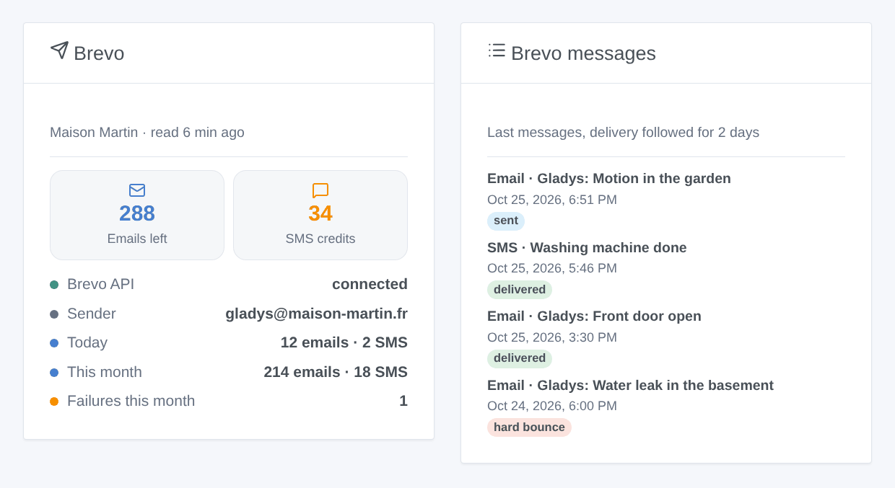
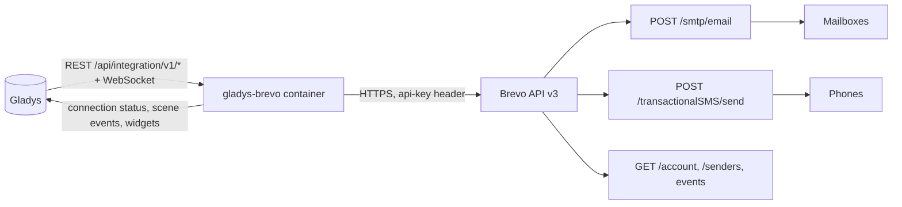
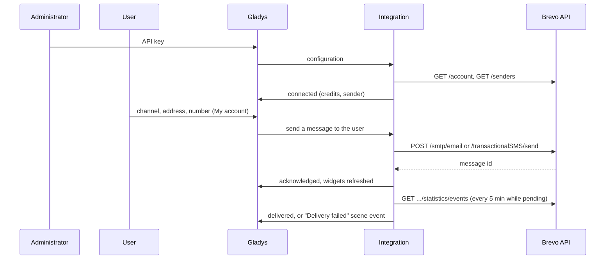

# Gladys Brevo

**English** · [Français](README.fr.md) · [Deutsch](README.de.md) · [Español](README.es.md)

[](LICENSE)
[](https://github.com/William-De71/gladys-brevo/releases)
[](https://github.com/William-De71/gladys-brevo/actions/workflows/release.yml)
[](https://gladysassistant.com)


[Gladys Assistant](https://gladysassistant.com) external integration that sends the notifications of Gladys **by email, by SMS or both through [Brevo](https://www.brevo.com)** (formerly Sendinblue), with its official API. Scenes can also email or text anyone, react to failed deliveries and to low SMS credits, and two dashboard widgets show the account and the last messages.

User documentation: [English](docs/en.md) · [Français](docs/fr.md) · [Deutsch](docs/de.md) · [Español](docs/es.md).

> Community integration, not affiliated with nor endorsed by Brevo.

## Features

- **Notification channel** (send-only): each user picks email, SMS or both in the "My account" block; every Gladys notification addressed to them leaves that way.
- **Camera snapshots as email attachments**; the subject is a prefix followed by the first line of the notification.
- **Automatic setup**: the first active email sender of the account, or the one of the configuration; national numbers get the default country code.
- **Delivery follow-up**: sent, delivered, bounced, blocked… read from the events of Brevo for two days.
- **Scene triggers**: message not sent, delivery failed, SMS credits low.
- **Scene actions**: send an email, send an SMS, read the Brevo account.
- **Dashboard widgets**: Brevo account, last messages.
- **Configuration screen buttons**: test the connection, send a test email and/or SMS.
- English, French, German and Spanish everywhere.



## How it works




From the configuration to a delivered message:



Every message carries the tag `gladys`: you find the messages of Gladys in the Brevo logs, and the integration matches the delivery events to the message ids it kept.

### Transport

`transports: ["cloud"]`: the integration only talks to the Brevo API (`api.brevo.com`). The texts, images, addresses and numbers leave your network for Brevo, then the mail servers and the mobile operators.

## Notifications, addresses and numbers

| Typed number         | Sent to                                  |
| -------------------- | ---------------------------------------- |
| `+33 6 12 34 56 78`  | `+33612345678`                           |
| `0033.6.12.34.56.78` | `+33612345678`                           |
| `06 12 34 56 78`     | `+33612345678` (default country code 33) |
| `+32 470 12 34 56`   | `+32470123456`                           |

An email holds the text and an HTML copy of it (escaped, line breaks kept), plus the camera image of the message when there is one. An SMS is a transactional SMS (never the "STOP" mention of marketing SMS), in unicode only when the text needs it, cut at 1,000 characters. With "Email and SMS", a notification fails only when neither channel went out.

## Scene triggers, actions and widgets

| Kind    | Key                | Use case                                                                         |
| ------- | ------------------ | -------------------------------------------------------------------------------- |
| Trigger | `message_not_sent` | Warn through the other channel when one stops working (credits, key, IP, Brevo)  |
| Trigger | `delivery_failed`  | Know that an alert did not arrive: bounce, block, spam report, SMS rejected      |
| Trigger | `credits_low`      | Top up the SMS credits before they run dry                                       |
| Action  | `send_email`       | Email someone who is not a Gladys user (neighbor, babysitter), or several people |
| Action  | `send_sms`         | Same by SMS                                                                      |
| Action  | `get_account`      | Credits and messages of the day or month in a report or a condition              |
| Widget  | `account`          | Credits, API state, sender, messages today and this month, failures              |
| Widget  | `activity`         | The last messages with their delivery status                                     |

Examples: _alarm goes off_ → SMS to the neighbor; _SMS not sent for lack of credits_ → email to the administrator; _hard bounce_ → notify the administrator with the masked recipient and the subject. A scene action never fires a trigger, and `message_not_sent` fires once per channel until a message goes through: a scene warning through the same channel cannot loop.

## Requirements

- Gladys Assistant 5.1.0 or later (widgets and scenes); older instances cannot install the integration.
- A Brevo account (free plan: 300 emails a day), a verified sender or an authenticated domain, SMS credits for the SMS.
- The public IP address of the house authorized in Brevo (Security → Authorized IPs) when the account blocks unknown addresses.

## Installation

- **From the store**: Integrations → Brevo → Install.
- **From the repository URL**: Integrations → external integration → `https://github.com/William-De71/gladys-brevo`.
- **Developer mode**: run `npm start` with the variables given by Gladys (see Development).

## Configuration

| Field                 | Default | Meaning                                               |
| --------------------- | ------- | ----------------------------------------------------- |
| API key               | —       | `secret` (`xkeysib-…`), stored encrypted              |
| Sender address        | auto    | First active sender of the account                    |
| Sender name           | Gladys  | Name the recipients see                               |
| Subject prefix        | Gladys  | `Gladys: <first line>`                                |
| SMS sender            | Gladys  | Up to 11 letters and digits                           |
| Default country code  | 33      | Added to numbers typed without one                    |
| Low SMS credits alert | 20      | Threshold of `credits_low`, 0 = off                   |
| Follow the delivery   | on      | Events every 5 min while a message waits, for 2 days  |
| My account            | —       | Per user: channel (email, SMS, both), address, number |

## Usage

1. Generate an API key in Brevo, paste it in the configuration, then click **Test the connection** and **Send a test**.
2. Each user chooses their channel and enters their address and/or number in **My account**.
3. Add the widgets to a dashboard, and build scenes with the triggers and actions.

## Development

```bash
npm install
npm test                       # node --test, never touches the network
npm run lint                   # ESLint
npm run format:check           # Prettier
npx github:GladysAssistant/integration-store . --skip-image-check
scripts/build-cover.sh         # cover.jpg from docs/assets/cover.svg
docs/illustrations/render.sh   # docs/assets/widgets.<lang>.png
```

Locally, the SDK reads `GLADYS_HOST_API_URL`, `GLADYS_INTEGRATION_TOKEN` and `GLADYS_INTEGRATION_SELECTOR` (given by Gladys in developer mode). `DEBUG=gladys-integration-sdk` shows the SDK logs.

The tests cover the API client (headers, error kinds, unknown IP address), the failure reasons, the account, the senders, the email and SMS bodies, the retries (429 only, after the announced reset), the delivery events and their matching across a restart, the addresses and numbers, the scene events and their transitions, the widgets (`validateWidgetContent`), the manifest, the four languages, the release script, and the whole integration against the fake Gladys of the SDK and a fake Brevo API. `test/structure.test.js` freezes every key users store.

## Release process


Every merge on `main` runs the CI, then computes the version from the [Conventional Commits](https://www.conventionalcommits.org/) since the last tag: `feat` → minor, `fix` / `perf` → patch, `!` or `BREAKING CHANGE` → major (a minor below 1.0.0); `docs`, `chore`, `ci`, `test`, `style`, `refactor`, `build` alone publish nothing. The changelog section is generated, the tag pushed, the multi-architecture image built, then `main` receives the release commit, the GitHub Release is created and a last job checks the public image, the store validator and the topic.

- The pull request title becomes the squash commit, then the changelog line: write it in English, for the user (`pr-title.yml` checks it). Never edit `CHANGELOG.md` by hand.
- 1.0.0 is a decision: Actions → Release → Run workflow with `release-as: 1.0.0`. `dry-run` shows the version and the notes without publishing.
- **Protected branch**: the release pushes its commit to `main` with `GITHUB_TOKEN`. With a ruleset on `main` stricter than "no deletion, no force push", add GitHub Actions to its bypass list (or push through a GitHub App), otherwise the publish job fails with instructions.
- After the first release, make the `ghcr.io` package public (Package settings → Change visibility), or Gladys cannot pull it.

## Troubleshooting

See [docs/en.md](docs/en.md#troubleshooting). Report issues with the versions of Gladys and of the integration, the plan, the channels used and the logs of the integration (addresses and numbers are masked; never paste the API key).

## Contributing

Issues and pull requests are welcome. Run `npm run format:check && npm run lint && npm test` before opening a pull request, and keep every stored key unchanged (see [CLAUDE.md](CLAUDE.md)).

## Security

See [SECURITY.md](SECURITY.md): report vulnerabilities privately. The API key is a `secret` field, sent only in the `api-key` header, never logged, never in a URL, a scene event or an error message. Addresses and numbers are masked in the logs, the scene events and `/data`. The text of a notification is always escaped in the HTML of the email. A send is never retried after a timeout or a server error, so an alert is not sent twice.

## Screenshots to come

The images above are illustrations, not screenshots. Real screenshots will go in `docs/assets/screenshots/` (PNG, 1280 × 800): `configuration.png`, `my-account.png`, `scene-trigger.png`, `dashboard.png`, `email.png`.

## License

[Apache License 2.0](LICENSE) — see also [NOTICE](NOTICE). Brevo is a trademark of Sendinblue SAS; this community integration is not affiliated with it. Thanks to the Gladys documentation and SDK.
